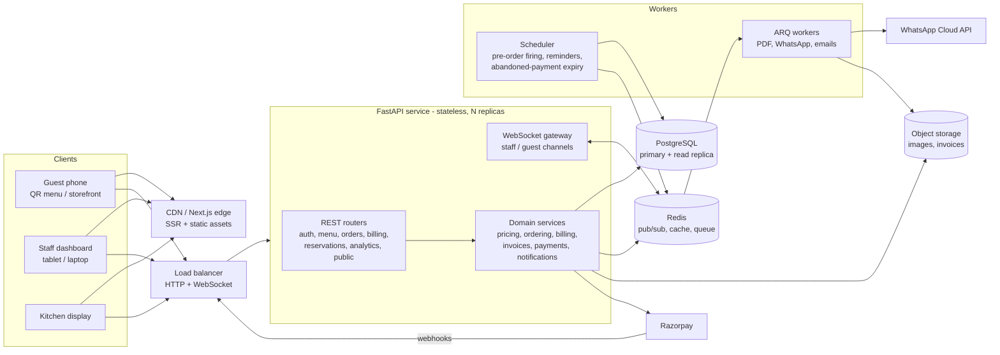
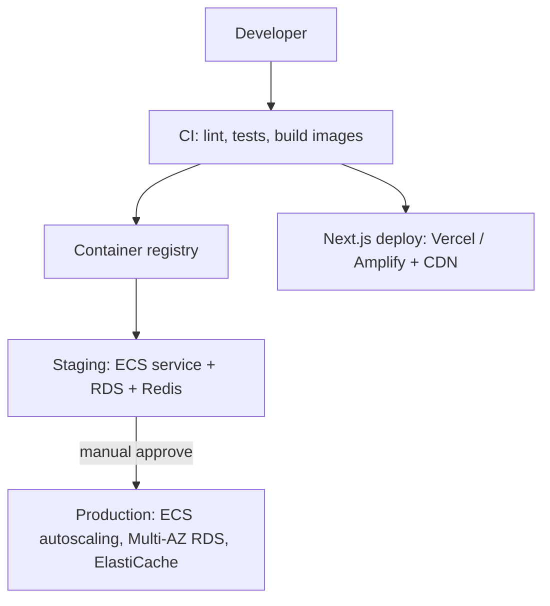

# DineOS — Tech Stack & High-Level Design (HLD)

## 1. Tech stack decisions

| Layer | Choice | Why |
|---|---|---|
| **Backend API** | **Python 3.12+ / FastAPI** (required) | Async I/O for WebSockets and payment webhooks, Pydantic v2 validation, auto OpenAPI docs, strong hiring pool |
| ORM / migrations | SQLAlchemy 2 (async) + Alembic | Mature, typed, works with Postgres and SQLite (dev) |
| Database | **PostgreSQL 16** (prod), SQLite (zero-setup dev) | ACID for money, JSONB for settings/modifier snapshots, row-level security for multi-tenancy later |
| Cache / pub-sub | **Redis 7** | Realtime fan-out across API instances, menu cache, rate limits, idempotency keys, job queue |
| Background jobs | ARQ (Redis) workers; in-process scheduler in dev | PDF generation, WhatsApp sends, pre-order firing, reminders |
| Realtime | WebSockets (FastAPI) + Redis pub/sub | Live order board, KDS, table status, guest order tracking |
| PDF | ReportLab | Pure Python, fast, no headless browser needed |
| Payments | **Razorpay** (UPI, cards, wallets, netbanking) behind a provider interface; mock provider for dev | Best UPI coverage in India; Stripe can plug in for other markets |
| WhatsApp | **Meta WhatsApp Cloud API** behind a provider interface; console provider for dev; `wa.me` share fallback | Official API, template messages with document header |
| Object storage | S3-compatible (AWS S3 / Cloudflare R2); local `media/` in dev | Menu images, invoice PDFs |
| **Frontend** | **Next.js (App Router) + TypeScript + Tailwind CSS** | One codebase for marketing site (SEO), guest web app (fast mobile), and dashboard; edge/CDN friendly |
| Client state | Zustand (cart, persisted), SWR (server cache + revalidation on realtime events) | Small, simple, no boilerplate |
| UI | Custom design system on Tailwind + lucide-react icons + sonner toasts | Lightweight, fully brandable per restaurant |
| Auth | JWT access (short) + refresh tokens for staff; signed **guest tokens** scoped to a table session/order | Guests never need an account |
| Infra | Docker, AWS (ECS Fargate or EKS), RDS Postgres, ElastiCache Redis, CloudFront + Vercel/Amplify for Next.js | Managed, autoscaling |
| Observability | OpenTelemetry traces, Prometheus metrics, Sentry errors, structured JSON logs | Debug payment and realtime issues fast |

## 2. Architecture diagram

## 3. Components

| Component | Responsibility |
|---|---|
| **Guest web app** (`/t/{qr}`, `/r/{slug}`) | Mobile-first menu, cart, ordering, bill, payment, tracking, booking. Uses guest tokens. |
| **Dashboard** (`/dashboard`) | Staff operations, role-based navigation, one WebSocket per device. |
| **KDS** (`/dashboard/kitchen`) | Full-screen ticket view; keeps working on a cheap Android tablet. |
| **Public API** (`/api/v1/public/*`) | Unauthenticated menu reads (cacheable); guest-token-protected writes. |
| **Staff API** (`/api/v1/*`) | JWT-protected, tenant-scoped by the user's `restaurant_id`. |
| **Realtime gateway** (`/ws/*`) | Subscribes the socket to channels: `staff:{restaurant}`, `session:{id}`, `order:{id}`. |
| **Broker** | `InMemoryBroker` (single process, dev) or `RedisBroker` (multi-instance). Same interface. |
| **Payment providers** | `MockProvider` (dev) and `RazorpayProvider` (orders API, signature verify, webhooks). |
| **WhatsApp providers** | `ConsoleProvider` (logs + audit row) and `MetaCloudProvider` (media upload + template send). |
| **Scheduler** | Fires scheduled pre-orders and expires unpaid online orders. |

## 4. Multi-tenancy
- **Shared database, shared schema**; every tenant-owned row carries `restaurant_id`.
- The staff JWT carries `restaurant_id`; all queries go through dependency-injected helpers that filter by it, so cross-tenant reads are structurally impossible from routers.
- Guest tokens are scoped to one session or order and can only reach that restaurant's data.
- Hardening path: Postgres row-level security (`SET app.restaurant_id`) plus per-tenant rate limits.

## 5. Realtime design
1. A domain service commits a change, then `broker.publish(channel, event)`.
2. Each API instance subscribes to Redis channels for its connected sockets and forwards events.
3. Clients treat events as *invalidation hints*: they refetch the affected resource over REST. This keeps the WebSocket protocol tiny, idempotent, and safe to drop; on reconnect, clients refetch everything.
4. Heartbeats every 25 s; exponential-backoff reconnects on the client.

## 6. Scalability & capacity

**Target:** 10,000 restaurants, peak dinner hour with 30 % of tables active.
- 10k × 20 tables × 30 % = **60k concurrent guest sessions**, plus ~30k staff/KDS sockets.
- Order writes at peak: about 60k sessions × 1.5 rounds/hour ≈ **25 orders/s** (easy for one Postgres primary).
- Menu reads dominate: about 2 menu loads per guest. Menus are cached in Redis (keyed by `restaurant_id` + `menu_version`) and served with `Cache-Control: s-maxage=30, stale-while-revalidate`, so the CDN absorbs most of them.
- WebSockets: about 10k sockets per API pod → 10 pods for headroom, autoscaled on connection count.
- Data growth: about 300 orders/restaurant/day → 3M orders/day → partition `orders`/`order_items` by month, archive to cold storage after 18 months, and run analytics off a read replica (later ClickHouse/BigQuery via CDC).

## 7. Reliability & correctness
- **Money in integer minor units** (paise); no floats anywhere in pricing.
- **Price snapshots**: order items copy name, price, and modifiers at order time, so menu edits never change past bills.
- **Idempotency**: guests send a `client_order_id`; duplicates return the original order. Payment verification is idempotent per provider payment ID.
- **Webhooks are the source of truth** for online payments; client-side verification is a fast path only.
- **Atomic counters** for daily order tokens and per-financial-year invoice numbers.
- **Graceful degradation**: if the WebSocket fails, clients poll; if WhatsApp fails, the guest still has PDF download and share links, and failures are logged in `notifications`.

## 8. Security
- bcrypt password hashing; JWT HS256 with rotation-ready secret; short-lived access tokens (60 min) + refresh (14 days).
- Role-based access: `owner > manager > cashier/waiter/kitchen`, enforced per route.
- Guest tokens are signed, typed, and scoped (`session`, `order`, `reservation`); invoice links use signed tokens.
- QR tokens are random 10-character, rotatable per table (re-print if leaked).
- Razorpay signatures verified with HMAC-SHA256; webhook secret is separate from the API secret.
- CORS allow-list in production; HTTPS only; rate limits on public writes (Redis token bucket).
- PII minimisation: guest phone is optional for dine-in and used only for invoices/notifications.

## 9. Deployment

- Blue/green deploys; Alembic migrations run as a pre-deploy job (expand → migrate → contract).
- Secrets in AWS Secrets Manager; per-environment config through env vars (`app/config.py`).
