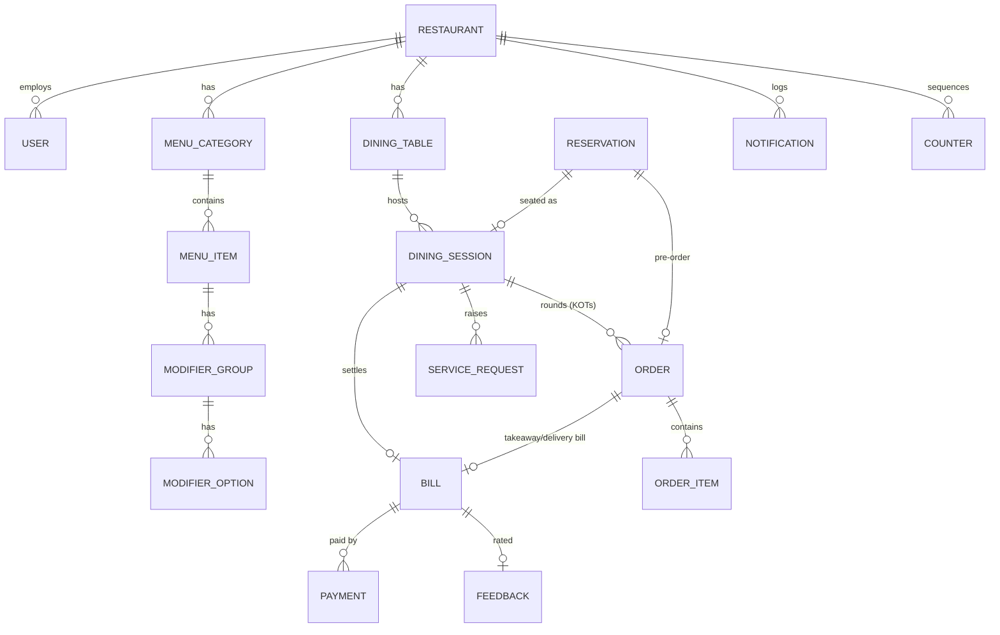
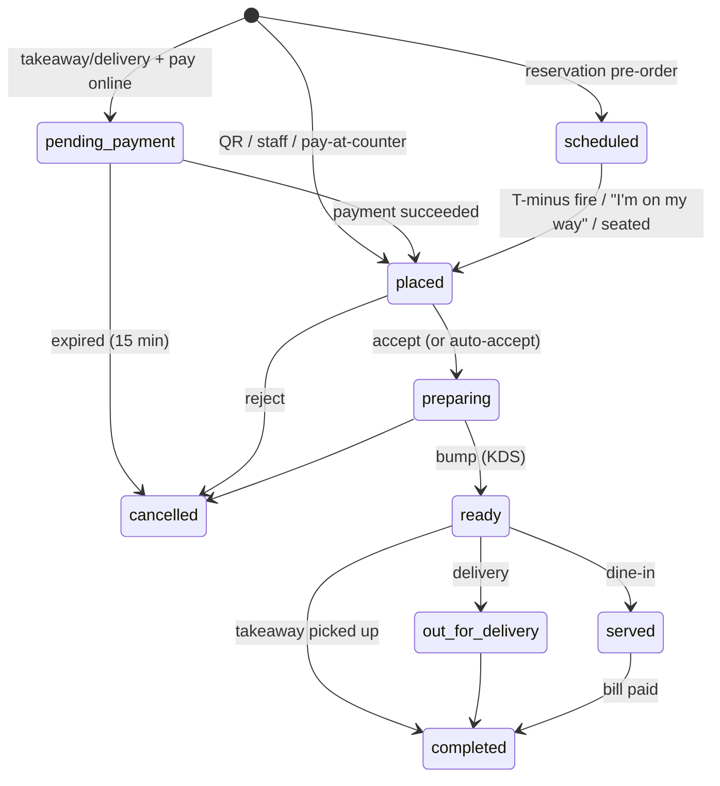
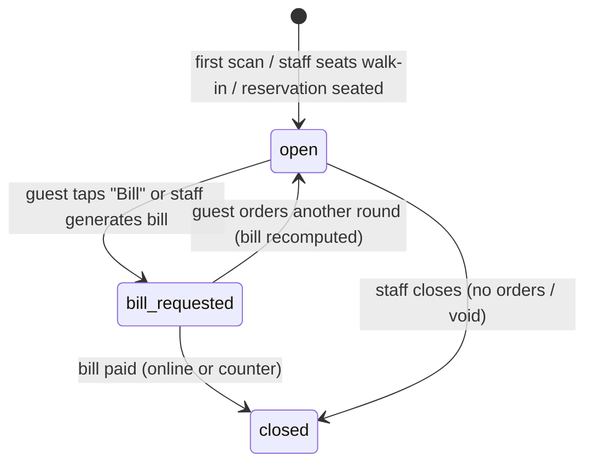
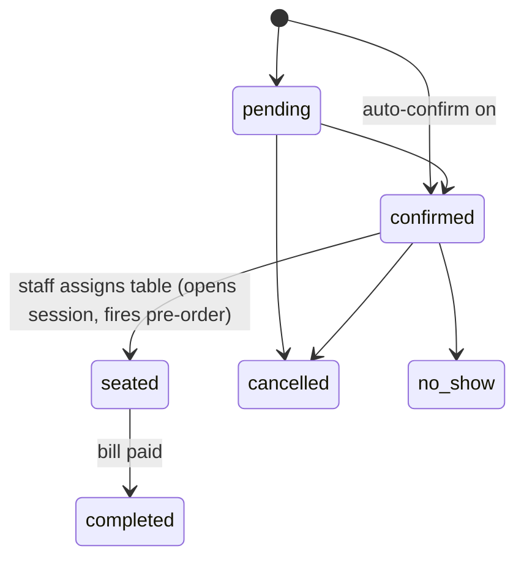
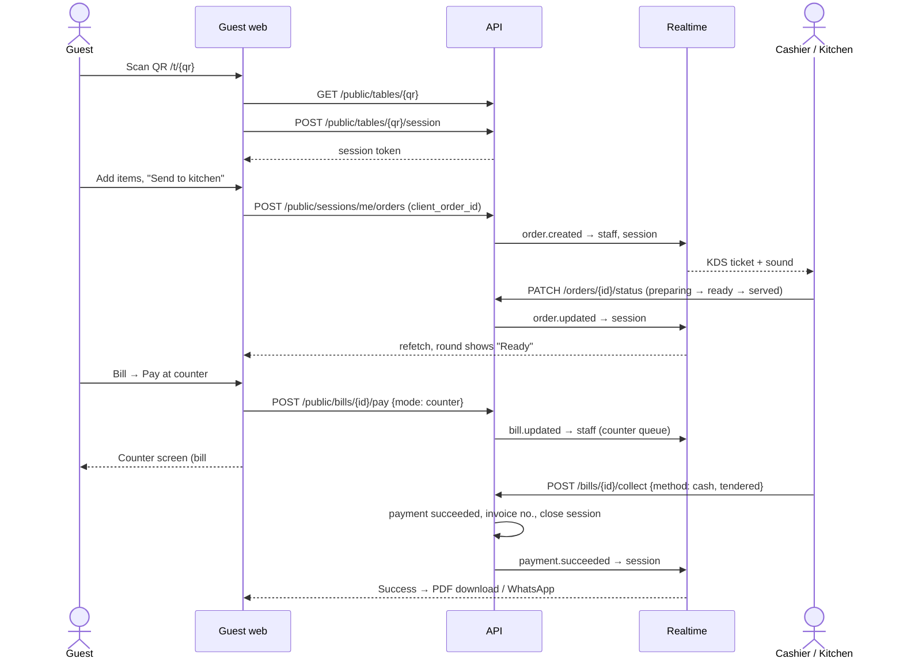
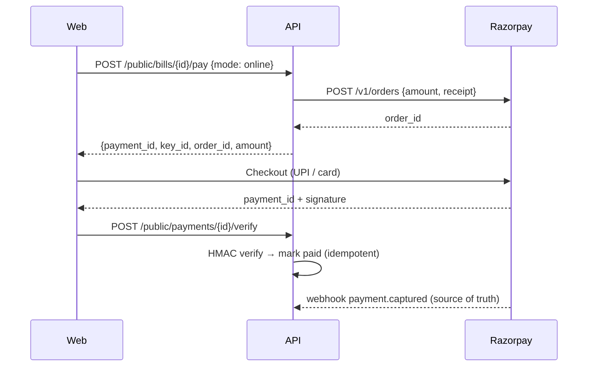
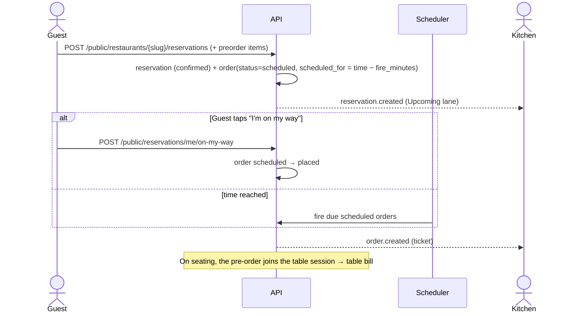

# DineOS — Low-Level Design (LLD)

## 1. Backend module layout

```
backend/app
├── main.py              # app factory, CORS, routers, lifespan (DB init, seed, scheduler)
├── config.py            # pydantic-settings (env driven)
├── db.py                # async engine/session, Base, UTCDateTime type
├── security.py          # bcrypt hashing, JWT (staff + guest tokens)
├── deps.py              # current user, role guards, guest-token guards
├── models/              # SQLAlchemy models (one module per aggregate)
├── schemas/             # Pydantic request/response models
├── routers/             # auth, restaurant, menu, tables, orders, sessions, billing,
│                        # reservations, analytics, staff, uploads, public, ws, plans
└── services/
    ├── pricing.py       # line pricing + bill totals (integer paise)
    ├── ordering.py      # order placement, status machine, numbering
    ├── billing.py       # bill build/recompute, payments, invoice numbering
    ├── reservations.py  # slot availability, seating, pre-order firing
    ├── invoice_pdf.py   # ReportLab GST invoice + QR table-tent sheet
    ├── payments.py      # PaymentProvider: Mock, Razorpay
    ├── whatsapp.py      # WhatsAppProvider: Console, MetaCloud
    ├── realtime.py      # Broker: InMemory, Redis + connection hub
    ├── counters.py      # atomic per-tenant sequences
    └── scheduler.py     # pre-order firing, payment expiry loop
```

## 2. Data model



All money columns are **integers in minor units** (paise). All timestamps are stored as UTC.

| Table | Key columns |
|---|---|
| `restaurants` | id, name, **slug (unique)**, tagline, description, cuisines[], logo_url, cover_url, phone, email, whatsapp_number, address_line, city, state, pincode, country, currency, timezone, gstin, fssai_number, settings (JSON), plan, plan_status, trial_ends_at, menu_version |
| `users` | id, restaurant_id, name, **email (unique)**, phone, password_hash, role (`owner/manager/cashier/waiter/kitchen`), is_active, last_login_at |
| `dining_tables` | id, restaurant_id, label, area, capacity, **qr_token (unique)**, is_active, sort_order |
| `menu_categories` | id, restaurant_id, name, description, icon, sort_order, is_active |
| `menu_items` | id, restaurant_id, category_id, name, description, price, image_url, diet (`veg/non_veg/egg/vegan`), tags[], spice_level, prep_minutes, is_available, is_active, sort_order |
| `modifier_groups` | id, item_id, name, min_select, max_select, sort_order |
| `modifier_options` | id, group_id, name, price_delta, is_available, is_default, sort_order |
| `dining_sessions` | id, restaurant_id, table_id, reservation_id, status (`open/bill_requested/closed`), guest_name, guest_count, customer_phone, opened_by, opened_at, closed_at |
| `orders` | id, restaurant_id, session_id?, reservation_id?, order_type (`dine_in/takeaway/delivery`), status, **number** (daily token), source (`qr/web/staff/reservation`), customer_name, customer_phone, notes, delivery_address (JSON), scheduled_for, **client_order_id** (idempotency, unique per tenant), subtotal, item_count, accepted/ready/completed/cancelled timestamps, cancel_reason |
| `order_items` | id, order_id, menu_item_id, **snapshot** name/diet/unit_price/modifiers, quantity, notes, line_total, is_done |
| `bills` | id, restaurant_id, session_id? / order_id?, invoice_number, status (`open/paid/void`), subtotal, discount, discount_reason, service_charge, taxes (JSON lines), tax_total, delivery_fee, round_off, total, amount_paid, customer_name, customer_phone, pay_preference (`online/counter`), counter_requested_at, paid_at |
| `payments` | id, restaurant_id, bill_id, method (`upi/card/cash/online`), provider (`razorpay/mock/manual`), status (`created/succeeded/failed`), amount, tendered, change_due, provider_order_id, provider_payment_id, collected_by, meta |
| `reservations` | id, restaurant_id, **code**, customer_name, customer_phone, customer_email, party_size, reserved_for, duration_minutes, status, occasion, notes, table_id, session_id, preorder_order_id, guest_on_way_at |
| `service_requests` | id, restaurant_id, table_id, session_id, kind (`waiter/water/cutlery/cleaning/bill/payment_help`), note, status (`open/resolved`), resolved_by |
| `feedback` | id, restaurant_id, bill_id, rating (1–5), comment |
| `notifications` | id, restaurant_id, channel, recipient, kind, status (`sent/simulated/failed`), provider, provider_message_id, error, payload |
| `counters` | (restaurant_id, key) PK, value — keys like `order:2026-11-19`, `invoice:26-27` |

### Settings document (`restaurants.settings`)
```json
{
  "dine_in_enabled": true, "takeaway_enabled": true, "delivery_enabled": true,
  "reservations_enabled": true, "preorder_enabled": true,
  "online_payment_enabled": true, "pay_at_counter_enabled": true,
  "auto_accept_orders": false, "avg_prep_minutes": 20,
  "taxes": [{"name": "CGST", "rate": 2.5}, {"name": "SGST", "rate": 2.5}],
  "prices_include_tax": false, "service_charge_percent": 0, "round_off": true,
  "delivery_fee": 4000, "min_delivery_order": 20000,
  "opening_time": "11:00", "closing_time": "23:00", "closed_weekdays": [],
  "reservation_slot_minutes": 30, "reservation_duration_minutes": 90, "max_party_size": 12,
  "preorder_fire_minutes_before": 15, "auto_confirm_reservations": true,
  "counter_directions": "Billing counter is next to the entrance.",
  "invoice_prefix": "SG", "invoice_footer": "Thank you! Visit again.",
  "theme_color": "#E8590C"
}
```

## 3. State machines

### Order


### Dining session & bill


### Reservation


## 4. API catalog (`/api/v1`)

### Auth & tenant
| Method | Path | Role | Purpose |
|---|---|---|---|
| POST | `/auth/signup` | — | Create restaurant + owner (+ sample menu & tables) |
| POST | `/auth/login` | — | Email/password → access + refresh |
| POST | `/auth/refresh` | — | Rotate access token |
| GET | `/auth/me` | any staff | Current user + restaurant |
| GET/PATCH | `/restaurant` | manager+ | Profile |
| PATCH | `/restaurant/settings` | manager+ | Settings document |
| GET | `/restaurant/onboarding` | any | Activation checklist |
| GET/POST/PATCH | `/staff`, `/staff/{id}` | owner/manager | Staff & roles |
| GET | `/plans` | — | Subscription plans |
| POST | `/uploads` | manager+ | Image upload → URL |

### Menu & tables
| Method | Path | Purpose |
|---|---|---|
| GET | `/menu` | Full menu (staff view incl. inactive) |
| POST/PATCH/DELETE | `/menu/categories[/{id}]` | Categories |
| POST/PATCH/DELETE | `/menu/items[/{id}]` | Items incl. modifier groups (replace semantics) |
| PATCH | `/menu/items/{id}/availability` | Mark in/out of stock |
| GET/POST/PATCH/DELETE | `/tables[/{id}]` | Tables |
| POST | `/tables/{id}/rotate-qr` | New QR token |
| GET | `/tables/{id}/qr.png?base_url=` | QR image |
| GET | `/tables-qr-sheet.pdf?base_url=` | Printable table tents (A4, 4 per page) |
| GET | `/tables/live` | Floor view: tables + session summary + open requests |

### Operations
| Method | Path | Purpose |
|---|---|---|
| GET | `/orders?status=&type=&active=` | Order list (board, KDS) |
| POST | `/orders` | Staff/waiter places order for a table or counter takeaway |
| PATCH | `/orders/{id}/status` | Status transition (validated) |
| PATCH | `/orders/{id}/items/{item_id}` | KDS item strike (`is_done`) |
| POST | `/orders/{id}/fire` | Fire a scheduled pre-order now |
| POST | `/sessions` | Seat walk-in at table |
| GET | `/sessions/{id}` | Session detail with orders & bill |
| POST | `/sessions/{id}/bill` | Generate/recompute bill |
| POST | `/sessions/{id}/close` | Close (void if unpaid & empty) |
| GET | `/bills?status=&counter=` | Bills (counter queue, open, paid) |
| GET | `/bills/{id}` | Bill detail |
| POST | `/bills/{id}/discount` | Apply discount (flat or %) |
| POST | `/bills/{id}/collect` | Record cash/card/UPI at counter (tendered → change) |
| GET | `/bills/{id}/invoice.pdf` | Invoice PDF |
| POST | `/bills/{id}/whatsapp` | Send invoice to WhatsApp |
| GET | `/service-requests?status=open` | Waiter calls |
| POST | `/service-requests/{id}/resolve` | Resolve |
| GET | `/reservations?date=` | Day list |
| PATCH | `/reservations/{id}` | Status/notes |
| POST | `/reservations/{id}/seat` | Assign table → session, pre-order into table bill |
| GET | `/analytics/summary?days=` | KPIs, time series, top items, splits |
| GET | `/feedback` | Ratings |

### Public (guest)
| Method | Path | Auth | Purpose |
|---|---|---|---|
| GET | `/public/restaurants/{slug}` | — | Storefront profile + public settings |
| GET | `/public/restaurants/{slug}/menu` | — | Menu (cacheable) |
| GET | `/public/tables/{qr}` | — | Resolve QR → restaurant + table + open session info |
| GET | `/public/qr/{qr}.png?base_url=` | — | QR image for a table (token is already public) |
| POST | `/public/tables/{qr}/session` | — | Join/create session → **session guest token** |
| GET | `/public/sessions/me` | session token | Session, orders, bill |
| POST | `/public/sessions/me/orders` | session token | Place round (idempotent `client_order_id`) |
| POST | `/public/sessions/me/requests` | session token | Call waiter etc. |
| POST | `/public/sessions/me/bill` | session token | Request bill |
| POST | `/public/restaurants/{slug}/orders` | — | Takeaway/delivery → **order guest token** |
| GET | `/public/orders/me` | order token | Tracking |
| POST | `/public/bills/{id}/pay` | session/order token | `online` → checkout payload, `counter` → counter screen |
| POST | `/public/payments/{id}/verify` | guest token | Razorpay signature verify |
| POST | `/public/payments/{id}/mock-complete` | guest token | Dev mock gateway |
| POST | `/public/payments/razorpay/webhook` | HMAC | Source of truth for online payments |
| GET | `/public/bills/{id}/invoice.pdf?token=` | signed | Invoice download |
| POST | `/public/bills/{id}/whatsapp` | guest token | Send invoice to WhatsApp |
| POST | `/public/bills/{id}/feedback` | guest token | Rating |
| GET | `/public/restaurants/{slug}/slots?date=&party_size=` | — | Reservation availability |
| POST | `/public/restaurants/{slug}/reservations` | — | Book (+ pre-order) → **reservation token** |
| GET | `/public/reservations/me` | reservation token | Status |
| POST | `/public/reservations/me/on-my-way` | reservation token | Fire pre-order now |
| POST | `/public/reservations/me/cancel` | reservation token | Cancel |

### WebSocket
- `/ws/staff?token=<access>` → channel `staff:{restaurant_id}`
- `/ws/guest?token=<guest>` → channel `session:{id}` / `order:{id}` / `reservation:{id}`

Event envelope: `{"type": "order.updated", "data": {"order_id": "...", "status": "ready"}, "ts": "..."}`

Event types: `order.created`, `order.updated`, `session.updated`, `bill.updated`, `payment.succeeded`, `service_request.created`, `service_request.resolved`, `reservation.created`, `reservation.updated`, `menu.updated`.

## 5. Key sequences

### QR dine-in → pay at counter


### Online payment (Razorpay)


### Booking with pre-cook


## 6. Algorithms

### Line pricing
`unit_price = item.price + Σ selected option.price_delta`, validated against each group's `min_select ≤ n ≤ max_select`, option availability, and item availability. `line_total = unit_price × qty`.

### Bill totals (integer paise)
```
subtotal        = Σ line_total of non-cancelled orders in the session (or the single order)
discount        = min(discount, subtotal)
base            = subtotal − discount
service_charge  = round(base × sc% / 100)                        # 0 by default (optional by law)
if prices_include_tax:
    gross = base + service_charge
    net   = round(gross × 100 / (100 + Σrate))
    tax_i = round(net × rate_i / 100) (last line absorbs rounding) → tax_total = gross − net
    pre   = gross + delivery_fee
else:
    tax_i = round((base + service_charge) × rate_i / 100)
    pre   = base + service_charge + Σtax_i + delivery_fee
total     = round_off ? nearest ₹1 of pre : pre
round_off = total − pre
```

### Numbering
- Order token: per-restaurant daily counter in the restaurant's timezone → `#042`.
- Invoice: `{prefix}/{FY}/{seq:05}` (FY Apr–Mar, e.g. `SG/26-27/00042`), assigned only when a bill is paid, which keeps the series gap-free as GST requires.

### Reservation availability
For each slot between opening and `closing − duration`, at step `slot_minutes`:
1. Collect active reservations overlapping `[slot, slot + duration)`.
2. Greedily assign them (largest party first) to the smallest table that fits.
3. The slot is available if a table with `capacity ≥ party_size` remains, and it is not in the past.

### Idempotency
`orders(restaurant_id, client_order_id)` is unique. A repeated POST returns the existing order (HTTP 200) instead of creating a duplicate. Payment success is applied once per bill (`bill.status` check inside the transaction).
